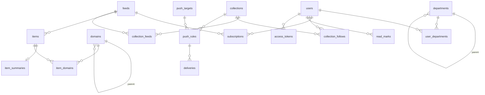

# Mimir 架构

- last_verified: 2026-10-16（设计稿，代码骨架尚未搭建）
- 本文件定**技术架构与边界**：系统拓扑、包职责、数据模型、关键机制与选型。功能细节、交互、排期不写在这里。表述与代码冲突时，先判断是哪边错了，然后修正其中一边，不能让两者长期不一致。
- 协作规则与工程纪律见 `AGENTS.md`。
- 许可：AGPL-3.0，外部贡献需签署 CLA（见 `LICENSE`、`CLA.md`）。

## 系统一句话

开源、自托管的组织级信息渠道服务：把外部信息源（RSS，以及 RSSHub 式的站点适配）统一抓取、去重、整理，按部门和领域组织分发给人（Web 阅读、IM 推送），并通过 MCP、API 和 RSS 输出给各业务和个人的 AI 进一步消费。AI 只做轻量加工（摘要和领域打标），重推理留给消费端。**飞书是第一优先的集成平台**，其他平台通过同一套接口接入。

## 产品边界（架构级约束）

| 约束 | 架构含义 |
| --- | --- |
| 开源自托管，**一套部署服务一个组织** | 单租户，不做 tenant 隔离。组织差异全部通过配置和管理后台表达，不在代码里写死 |
| 信息源只来自**外部**，不接内部系统 | 没有 Push/Webhook 入口；所有内容都由 worker 主动抓取 |
| 设计规模：几百用户，每人约 100 个源 | feed 全局去重后约 5k–20k 个，新增约 2–5 万条/天 |
| 参考部署：单台 2 核 4G 云服务器 | 单机 docker compose；不引入 Redis、MQ 或搜索引擎；Postgres 是唯一的有状态组件 |
| 飞书优先，平台可插拔 | 登录、通讯录、消息推送都定义成接口（见「集成」），飞书是首个完整实现 |
| 外部模型 API | LLM 藏在任务级抽象后面，模型和网关可以通过配置切换 |
| AI 只做摘要（含领域打标），暂不做 embedding 和翻译 | 不建向量存储；翻译和语义检索留到需要时再加，现在不预建 |

## 拓扑

```mermaid
flowchart LR
  subgraph 外部
    SRC[RSS/Atom/JSON Feed 站点]
    HUB[RSSHub 实例<br/>自建或公共]
    WEB[目标站点 HTML/API]
    LLM[外部 LLM API]
    FS[飞书开放平台<br/>OAuth · 通讯录 · 消息]
  end
  subgraph 服务器 docker compose
    subgraph mimir 镜像
      API[api 角色<br/>Hono: REST · MCP · RSS 输出 · 静态 Web]
      WK[worker 角色<br/>抓取 · 摘要 · 推送 · 通讯录同步]
    end
    PG[(PostgreSQL)]
    RH[rsshub 容器<br/>可选]
  end
  U[浏览器] -->|HTTPS| API
  AG[业务/个人 AI] -->|MCP Streamable HTTP · PAT| API
  RD[RSS 阅读器/自动化] -->|带 token 的 Atom| API
  API <--> PG
  WK <--> PG
  API -->|登录 OAuth| FS
  WK -->|通讯录同步 · 消息卡片| FS
  WK -->|http(s) feed| SRC
  WK -->|rsshub://| HUB
  WK -->|rsshub://| RH
  WK -->|site:// 适配器| WEB
  WK -->|摘要预热| LLM
  API -->|按需摘要| LLM
```

- **一个镜像，两种角色**：同一份代码，用 `MIMIR_ROLE=api|worker|all` 决定启动哪些循环。起步用 `all` 跑一个容器；以后需要隔离负载时，拆成两个容器、各跑一个角色，代码不用改。
- **Postgres 是唯一事实源，同时承担队列**：不引入 pg-boss、Redis 之类的队列组件。抓取调度用 `feeds.next_fetch_at`，摘要任务用 `item_summaries.status`，推送用 `deliveries.status`，都通过 `FOR UPDATE SKIP LOCKED` 加租约认领（"表即队列"）。好处是多 worker 天然互斥，进程崩溃后靠租约超时就能恢复，而且没有第二份状态。
- **api 和 worker 不互相调用**，只通过数据库交接状态。唯一的例外是按需摘要：api 进程可以就地执行同一个摘要函数，互斥规则见「AI 摘要」一节。

## 仓库布局（bun workspaces）

```
mimir/
├── apps/
│   ├── server/        # Hono 服务：api 与 worker 两种角色的唯一后端代码
│   └── web/           # Vite + React SPA，生产构建后由 server 托管静态文件
├── packages/
│   ├── shared/        # zod 契约与类型（前后端共用），framework-free
│   └── sources/       # 信息源抽象：Provider、站点适配器、Pipeline transforms；无 DB 依赖
├── e2e/               # Playwright 用户旅程测试（独立 workspace，不被其他包依赖）
├── openspec/          # 行为规格（specs/）与变更提案（changes/），见「工程约束」
├── deploy/            # docker compose、Dockerfile、反向代理配置
├── docs/              # 用户文档（部署、配置、飞书接入）与设计 memo（docs/memos/）
└── reference/         # git-ignored 上游参考项目，见 reference/README.md
```

| 包 | 职责 | 允许依赖 |
| --- | --- | --- |
| `apps/server` | HTTP 路由、鉴权、MCP、RSS 输出、DB（Drizzle schema 和迁移）、调度循环、LLM 任务、平台集成（`src/integrations/`） | `shared`、`sources` |
| `apps/web` | 全部 UI；通过 Hono RPC 类型化客户端调用 server | `shared`；**只引用 server 的路由类型**（`import type`） |
| `packages/shared` | API 输入输出的 zod schema、枚举、跨端共用的纯函数 | 只依赖 `zod` |
| `packages/sources` | 输入 source URI 和配置，输出标准化的 `FeedResult`；不碰数据库，不知道用户和订阅 | 只依赖抓取和解析库，不依赖其他 workspace 包 |

`sources` 独立成包是这套架构里最重要的边界：站点适配和特殊处理是变化最频繁、也最适合社区贡献的部分，必须能脱离数据库单独开发和测试（给一个 URI 就能跑出 items）。

## 技术选型

| 层 | 选型 | 说明 |
| --- | --- | --- |
| 运行时 | Bun 1.4+ | 用原生 `fetch` 的 `proxy` 选项实现按源走代理；`Bun.randomUUIDv7()` 生成 ID |
| HTTP | Hono 4 + `@hono/zod-validator` | 用 Hono RPC（`hc`）给 web 提供端到端类型 |
| DB | PostgreSQL 17 + Drizzle ORM + `drizzle-kit` | 驱动统一用 `pg`；迁移文件入库 |
| 鉴权 | better-auth 1.7 | 飞书走 genericOAuth 插件（1.7 起通用 provider 与内置 provider 共用 `signIn.social` 和 `/api/auth/callback/<id>`）；另支持通用 OIDC 和本地密码（试用场景）。Web 用 session；MCP、API、RSS 输出用个人访问令牌（PAT） |
| 飞书 | `@larksuiteoapi/node-sdk` | 通讯录和消息；同时支持飞书（`open.feishu.cn`）和 Lark 国际版（`open.larksuite.com`） |
| MCP | `@modelcontextprotocol/sdk`，Streamable HTTP | 挂在 `/mcp` |
| LLM | Vercel AI SDK（`ai` + `@ai-sdk/openai-compatible`） | 用 `generateObject` 加 zod schema 得到结构化输出 |
| Feed 解析 | `feedsmith` | 支持 RSS、Atom、RDF、JSON Feed |
| HTML | `cheerio`（站点适配器，与 RSSHub 一致）、`@mozilla/readability` + `linkedom`（正文提取）、`sanitize-html`（入库前清洗） | |
| 定时 | `croner` | 只用于 worker 内的周期任务（通讯录同步、摘要推送、清理），不负责抓取调度 |
| 前端 | React 19 + Vite 8 + TanStack Router（代码式路由）/ Query + Tailwind CSS 4 + react-i18next | 界面多语言，默认 `zh-CN`，另提供 `en`。组件按需手写；列表变长再引入 TanStack Virtual，需要成套组件时再评估 shadcn/ui |
| 工程 | TypeScript 7 strict、oxlint + oxfmt、`bun test`、Playwright、OpenSpec | 见「工程约束」 |
| 日志 | `pino`，输出 JSON 到 stdout | |

> 以上依赖在 v0 骨架阶段逐个在 Bun 上验证过，结论见 `docs/memos/2026-10-16-v0-skeleton.md`。

## 集成（`apps/server/src/integrations/`）

组织相关的外部平台能力拆成三个接口。每个平台一个目录（`integrations/feishu/`、`integrations/oidc/`……），实现自己支持的那部分接口，通过配置启用。业务代码只依赖接口，不 import 具体平台。

| 接口 | 职责 | 飞书实现 | 其他实现 |
| --- | --- | --- | --- |
| `AuthProvider` | 登录，产出外部身份（`provider` + `external_id` + 姓名、邮箱、头像） | 网页应用 OAuth（genericOAuth） | 通用 OIDC、本地密码 |
| `DirectoryProvider` | 拉取部门树和成员归属，写入 `departments` 和 `user_departments` | 通讯录 API 全量同步（周期执行） | `manual`：管理员在后台维护 |
| `Notifier` | 把一组 items 投递到某个目标（人或群） | 自建应用机器人发消息卡片（目标：用户 open_id 或群 chat_id）；群自定义机器人 Webhook（无需建应用） | 社区按同一接口贡献：钉钉、企业微信、Slack、邮件、通用 Webhook |

- **同步是单向的**：IdP 是部门和成员归属的事实源，Mimir 只读不写回。启用 `DirectoryProvider` 后，后台里的部门变成只读，防止出现两份事实。
- **身份关联**：一个用户可以绑定多个外部身份（由 better-auth 的 accounts 表承载）。通讯录同步按 `(provider, external_id)` 匹配用户；同步时还没登录过的成员先建成"未激活"用户，以便部门默认订阅和推送规则能提前生效。
- **飞书凭据**：一个自建应用（`app_id` / `app_secret`）同时提供登录、通讯录和机器人三种能力，所需权限范围在 `docs/` 的飞书接入文档里列全。`tenant_access_token` 由 SDK 缓存刷新，不落库。
- **暂不接事件订阅**：v0 只做主动调用（登录、周期同步、发消息），不需要配置飞书回调地址。通讯录实时变更和机器人指令放到演进位置。

## 数据模型

ID 统一用 UUIDv7（应用代码生成），时间列统一用 `timestamptz`。下面只列关键列，以 Drizzle schema 为准。



**组织维度**

- `departments(id, parent_id, name, source[manual|<provider>], external_id)`：组织树。
- `users(id, status[active|inactive], role[member|admin], locale, ...)`：认证相关的表由 better-auth 管理。
- `user_departments(user_id, department_id, is_primary)`：一个人可以属于多个部门（飞书允许）。
- `domains(id, parent_id, name, description)`：领域分类，由管理员维护，层级不深。`description` 会作为摘要打标时提示词的一部分。

**信息源**

- `feeds(id, source_uri UNIQUE, title, site_url, config, status[active|paused|dead], etag, last_modified, next_fetch_at, last_fetched_at, last_error, error_count, avg_interval)`
  - `source_uri` 是 feed 的全局身份（见「信息源抽象」）。同一个 URI 全组织只抓一次。
  - `config`（jsonb）：抓取间隔覆盖值、是否走代理、transforms 管线声明，对应 `sources` 包的 `SourceConfig`。
- `subscriptions(user_id, feed_id, title_override, folder, created_at)`：个人订阅。
- `collections(id, name, owner_user_id, department_id?, domain_id?, visibility[public|department|private], is_department_default)`：一组 feed 的打包，可以归属某个部门或领域。
- `collection_feeds(collection_id, feed_id)`；`collection_follows(user_id, collection_id)`：关注是**动态**的。Collection 增删 feed 后，所有关注者立即看到变化，不会把 feed 复制成个人订阅。
- **可见性**：`department` 可见的 Collection，对该部门**及其下级部门**的成员可见。
- **用户的可见 feed 集合 = 个人订阅 ∪ 已关注 Collection 的 feed**。这个集合只由一个函数计算，Web、API、MCP、RSS 输出都调用它，不允许各自再写一份。
- 部门默认订阅：`is_department_default` 为 true 的 Collection，会被本部门及下级部门的成员自动关注（入职、调岗、通讯录同步时触发）。
- feed 没有任何订阅者、也不在任何 Collection 里时，停止抓取。

**内容**

- `items(id, feed_id, guid_hash, url, url_hash, title, author, published_at, content_html, content_purged_at, image_url, simhash, created_at)`
  - 唯一约束为 `(feed_id, guid_hash)`。guid 缺失时，依次用规范化 URL、标题加发布时间兜底。
  - `content_html` 是**清洗后**的 HTML。过了保留期（默认 30 天）且没有人星标的条目，清空正文并记录 `content_purged_at`，元数据长期保留。
  - `url_hash`（规范化 URL，去掉 utm 等参数）和 `simhash`（标题）用来识别跨 feed 的重复内容。v0 只在列表展示时合并，不建聚类表。
- `item_summaries(item_id PK, status[pending|running|done|failed], summary, model, lease_until, attempts, error, created_at, updated_at)`：AI 派生数据和源数据分表存放。
- `item_domains(item_id, domain_id)`：由摘要任务写入，用于按领域筛选。

**用户状态**

- `read_marks(user_id, feed_id, read_before)`：按 feed 记录的已读水位线。"全部标为已读"只需推进水位线。
- `item_states(user_id, item_id, read_at, starred_at)`：记录水位线之后的单条已读和星标。
- 判断某条是否未读：`published_at > read_before` 且 `item_states.read_at` 为空。

**推送**

- `push_targets(id, notifier, kind[user|group|webhook], address, secret, name, owner_user_id)`：投递目标。例如飞书群（`chat_id`）、飞书用户（`open_id`）、群机器人 Webhook。`secret`（Webhook 地址或签名密钥）加密存储，密钥来自 `MIMIR_SECRET_KEY`。
- `push_rules(id, collection_id, target_id, mode[realtime|digest], schedule, filter, enabled)`：把一个 Collection 推送到一个目标。`realtime` 表示有新条目就攒批推送，`digest` 表示按 cron 汇总推送；`filter` 复用 transforms 里 `filter` 的语义（关键词、领域）。
- `deliveries(id, rule_id, item_id, status[pending|sent|failed], lease_until, attempts, sent_at)`：唯一约束为 `(rule_id, item_id)`，保证同一条目不会重复推送；同时承担推送队列。
- v0 推送的粒度是 Collection。个人订阅的推送（"我关注的源有更新时私聊我"）放到演进位置。

**令牌与审计**

- `access_tokens(id, user_id, name, token_hash, scopes, last_used_at, expires_at, revoked_at)`：明文只在创建时展示一次，库里只存 hash。前缀 `mmr_`。
- `access_logs(id, token_id, surface[mcp|api|rss], action, at)`：只记录调用了什么，不记录返回内容。

## 信息源抽象（`packages/sources`）

```
source URI ──► Provider.fetch() ──► RawFeed ──► Pipeline（按 config 顺序执行 transforms）──► FeedResult
```

### Source URI

| scheme | 示例 | 含义 |
| --- | --- | --- |
| `https:` / `http:` | `https://example.com/rss.xml` | 原生 feed（RSS、Atom、RDF、JSON Feed） |
| `rsshub:` | `rsshub://github/trending/daily` | RSSHub 路由，运行时解析到配置好的实例（`MIMIR_RSSHUB_URLS`，可以配多个，按顺序回退） |
| `site:` | `site://36kr/newsflash` | Mimir 自己的站点适配器 |

URI 必须**规范化**以后再入库（scheme 和 host 转小写、去掉末尾斜杠、去掉追踪参数），这是 feed 全局去重的前提。`rsshub://` 不绑定具体实例，所以换 RSSHub 实例不影响已有订阅。

### 核心类型

`FeedResult` 和 `FeedItem` 的字段**对齐 RSSHub 的 `Data` / `DataItem`**（`title`、`link`、`description`、`pubDate`、`guid`、`author`、`category`、`image`、`enclosure_*` 的子集）。这样做的目的是：从 RSSHub 拿到的 JSON Feed 输出，以及从 RSSHub 移植过来的路由，都可以几乎原样接入。

```ts
interface SourceProvider {
  schemes: string[]         // 例如 ['http:', 'https:']
  fetch(uri: URL, ctx: FetchContext): Promise<ProviderResult>   // { feed: RawFeed, etag?, lastModified? } | { notModified: true }
}

interface FetchContext {
  http: HttpClient          // 已经绑定好代理、超时、UA、体积上限、SSRF 防护、按 host 限速
  conditional: { etag?: string; lastModified?: string }
  signal?: AbortSignal
}

// site:// 适配器：形态与 RSSHub route 对齐（Hono 风格的 path、parameters、example），handler 输出 Data 子集
interface SiteRoute {
  path: string              // 例如 "/36kr/:channel"
  name: string
  url: string
  example: string
  parameters?: Record<string, string>
  handler(params: Record<string, string>, ctx: FetchContext): Promise<FeedResult>
}
```

- `site` provider 按 path 匹配到对应的 `SiteRoute`。适配器目录为 `packages/sources/src/sites/<site>/`，一个站点一个目录，带 fixture 测试。这也是社区贡献的主要入口。
- 只有 `FetchContext.http` 能发出网络请求。适配器和 transforms **不得**直接调用全局 `fetch`，否则代理、限速和 SSRF 防护就会被绕过。

### Pipeline transforms

在 `SourceConfig.transforms` 里按顺序声明，不需要写代码：

| transform | 作用 |
| --- | --- |
| `fulltext` | feed 只给摘要时，抓取原文并用 readability 提取正文（可以指定 CSS 选择器覆盖提取结果） |
| `select` | 用 CSS 选择器保留或删除元素（广告、推荐阅读） |
| `filter` | 按关键词或正则保留、丢弃条目 |
| `rewrite` | 修正相对链接、图片地址 |

声明式 transform 搞不定的站点，升级成一个 `site://` 适配器，不往 transform 里加站点特例。HTML 清洗（`sanitize-html`）是 pipeline 末尾**固定执行**的一步，不能配置、不能跳过。

## 抓取调度（worker）

- **认领**：循环执行 `SELECT … WHERE status='active' AND next_fetch_at <= now() ORDER BY next_fetch_at LIMIT n FOR UPDATE SKIP LOCKED`，并把 `next_fetch_at` 推后一个租约时长作为占位。进程崩溃时，租约到期后这个 feed 会被自然重新认领。
- **并发**：全局并发上限，加上按 host 的令牌桶（同一个站点的多个 feed 共享）。
- **条件请求**：发送 ETag 和 Last-Modified，收到 304 只更新时间戳。
- **自适应间隔**：根据近期发文间隔推算，限制在 `[10m, 24h]`，默认 30 分钟，`config` 可以覆盖。
- **失败退避**：指数退避，上限 24 小时；连续失败超过阈值（例如 7 天）标记为 `dead` 并在 UI 提示，人工恢复。
- **入库**：按 `(feed_id, guid_hash)` upsert。已存在的条目只在标题或正文有实质变化时更新，不制造"新条目"。新条目入库时，在同一个事务里为命中的 `push_rules` 写入 `deliveries`。
- **SSRF 防护**：订阅地址由用户输入，所以必须在 DNS 解析之后拒绝私网、回环、链路本地地址和云厂商元数据地址（如 `169.254.169.254`、阿里云的 `100.100.100.200`），重定向的每一跳都要重新校验。这一步在 `HttpClient` 里统一实现：默认只放行公网单播地址，`MIMIR_FETCH_ALLOWED_CIDRS` 可以显式追加网段（典型场景是本机 fake-IP 代理返回的 `198.18.0.0/15`）。
- **停止抓取**：没有订阅者、也不在任何 Collection 里的 feed 不再被认领，数据保留；重新被订阅时立即恢复。
- **周期任务**（croner）：通讯录同步、`digest` 推送、正文保留期清理、`dead` feed 汇总、过期令牌清理。

## AI 摘要

- **任务抽象**：`apps/server/src/llm/` 下一个任务一个模块，`summarize` 是第一个。每个任务自己定义 prompt 和 zod 输出 schema，模型通过 `MIMIR_LLM_<TASK>_MODEL` 配置。所有调用都经过 AI SDK 的 OpenAI 兼容 provider，`baseURL`、`apiKey` 和代理都走配置。
- **输出**：一次调用返回 `{ summary: string, domains: string[] }`。摘要语言取实例默认语言（`MIMIR_DEFAULT_LOCALE`）。领域只能从现有的 `domains` 表里选（候选列表写进 prompt），选不中就留空，不新建领域。
- **触发**：
  - **按需**：用户打开文章、MCP 请求或推送需要摘要时，如果还没有摘要，就当场生成。
  - **预热**：新条目所属的 feed 在部门或领域 Collection 里、有推送规则命中，或者订阅人数达到阈值时，插入一行 `pending`，由 worker 的摘要循环认领执行。
- **单飞互斥**：`INSERT … ON CONFLICT DO NOTHING` 加上 `status` 和 `lease_until` 租约，保证同一条目同一时刻只有一个进程在生成，其他请求等待或轮询结果。生成结果全组织共享，每条只算一次。
- **预算**：每日 token 上限（配置项）。超过上限后停止预热，只保留按需生成。失败按 `attempts` 有限重试。
- **不配置 LLM 时**：摘要功能整体关闭，其他功能照常可用。推送卡片退回为使用 feed 自带的摘要。
- 不做 embedding，也不做翻译。真正需要时再加新任务模块，表结构按需扩展。

## 对外接口

| 面 | 路径 | 鉴权 | 说明 |
| --- | --- | --- | --- |
| Web API | `/api/*` | session | Hono RPC，供 `apps/web` 使用 |
| MCP | `/mcp` | `Authorization: Bearer mmr_…` | Streamable HTTP，无状态 |
| RSS 输出 | `/out/*.xml?token=` | PAT（query 参数，因为 RSS 阅读器通常只支持 URL） | Atom 格式；可以输出个人时间线、某个 Collection、某个领域 |
| Web 静态资源 | `/*` | — | SPA 回退到 `index.html` |

**MCP 工具**：保持少而精，返回精简的结构化数据，正文按需单独获取。

| 工具 | 说明 |
| --- | --- |
| `list_subscriptions` / `list_collections` | 当前身份可见的源和 Collection |
| `search_items` | 关键词检索，可以按 feed、Collection、领域、时间过滤，游标分页 |
| `get_updates` | 从 `since` 游标开始增量拉取，返回新游标；供 Agent 定时巡检 |
| `get_item` | 正文加摘要（没有摘要时按需生成） |

所有接口的数据范围都等于"用户可见 feed 集合"，与 Web 端使用同一套计算。

**检索**：v0 在用户可见 feed 范围内，对 `title` 和摘要做 `ILIKE` 匹配，并限制时间窗，单次查询的数据量有界。中文检索质量或性能不够时，再评估 Meilisearch（属于引入新的有状态组件，需要单独写 memo）。

## 配置

开源自托管意味着组织差异都要靠配置表达。配置分两层，各有唯一归属：

| 层 | 放在哪里 | 内容 |
| --- | --- | --- |
| 部署配置 | 环境变量，启动时由 `apps/server/src/config.ts` 用 zod 校验，失败直接退出 | 数据库、密钥、公开地址、启用哪些集成及其凭据、LLM、RSSHub 实例、代理、预算、保留期、默认语言 |
| 业务配置 | 数据库，通过管理后台维护 | 部门（未启用通讯录同步时）、领域、Collection、推送目标与规则、feed 的 `config` |

- 同一项配置只能属于其中一层，不做"环境变量覆盖数据库"这类叠加。
- 仓库提交 `.env.example`，每个变量都有注释和默认值说明；`docs/` 里提供配置参考和飞书接入指南。
- **最小可运行配置**：`DATABASE_URL`、`MIMIR_PUBLIC_URL`、`MIMIR_SECRET_KEY`，再加一种登录方式（试用时可以只开本地密码）。LLM、RSSHub、飞书、代理都是可选的，不配置时对应功能关闭，其余功能照常可用。
- 主要变量：
  - 基础：`DATABASE_URL`、`MIMIR_ROLE`、`MIMIR_PUBLIC_URL`、`MIMIR_SECRET_KEY`、`MIMIR_DEFAULT_LOCALE`
  - 集成：`MIMIR_AUTH_PROVIDERS`（如 `feishu,password`）、`MIMIR_DIRECTORY_PROVIDER`（`feishu|manual`）、`MIMIR_FEISHU_APP_ID` / `MIMIR_FEISHU_APP_SECRET` / `MIMIR_FEISHU_DOMAIN`（`feishu|lark`）、`MIMIR_OIDC_*`
  - 抓取：`MIMIR_RSSHUB_URLS`、`MIMIR_FETCH_PROXY`、`MIMIR_FETCH_ALLOWED_CIDRS`、`MIMIR_FETCH_CONCURRENCY`
  - AI：`MIMIR_LLM_BASE_URL` / `MIMIR_LLM_API_KEY` / `MIMIR_LLM_SUMMARY_MODEL`、`MIMIR_LLM_DAILY_TOKEN_BUDGET`
  - 数据：`MIMIR_CONTENT_RETENTION_DAYS`

## 部署

- `deploy/Dockerfile` 构建单镜像（web 构建产物由 server 通过 `MIMIR_WEB_DIST` 托管）。`deploy/docker-compose.yml` 包含：`mimir`（`MIMIR_ROLE=all`）、`postgres`、`caddy`（TLS 和反向代理，配置见 `deploy/Caddyfile`）、`rsshub`（`--profile rsshub` 可选，不带 puppeteer）。部署配置写在 `deploy/.env`。镜像计划发布到 GHCR。
- 本地开发只用 `deploy/docker-compose.dev.yml` 起 Postgres，端口绑定 `127.0.0.1:55432`（显式绑回环地址，避免与本机其他服务或 OrbStack 的端口转发冲突）。
- 2 核 4G 的内存预算：mimir 约 500MB，Postgres 1–1.5GB（调整 `shared_buffers`），rsshub 约 300MB，其余留给系统和页缓存。触发升配的条件：需要 puppeteer 类的 RSSHub 路由，或者 worker 的抓取延迟持续超过调度间隔。
- 备份：每天执行 `pg_dump`，上传到 S3 兼容的对象存储（如阿里云 OSS）。

## 工程约束

- **测试分层**：
  - `packages/sources`：纯单元测试 + fixture，网络通过注入的假 `fetch` / `lookup` 模拟，不访问真实网络。
  - `apps/server`：集成测试直接连真实 Postgres（`TEST_DATABASE_URL`，默认 dev 实例上的 `mimir_test` 库，首次自动建库并迁移，每个用例前清表），不 mock 数据库。路由测试通过 `app.request()` 走完整中间件链。
  - `apps/web`：纯函数单测，以及 `zh-CN` / `en` 文案 key 一致性测试。
  - `e2e/`：Playwright 用户旅程。启动真实 server（托管 web 构建产物）、独立的 `mimir_e2e` 库，以及本地 fixture feed 服务；每个旅程覆盖一条完整用户路径，而不是逐个点按钮。
- **行为规格**：`openspec/specs/` 用 OpenSpec 记录用户可观察行为（需求 + 场景）。改变可观察行为的工作先写 `openspec/changes/<change>/` 提案，实现合入时归档并更新 specs。纯重构、依赖升级、文档改动不需要提案。`bun check` 会对所有 spec 和 change 做 strict 校验。
- **CI**（`.github/workflows/ci.yml`）：`bun check`、`bun run test`、`bun run e2e`，Postgres 由 service container 提供。

## 演进位置（明确不在当前范围）

以下能力**不预建抽象**，到时候各写一份 memo：embedding 与语义检索、翻译、个人日报和全组织热点、个人订阅推送、飞书事件订阅（通讯录实时变更、机器人指令如订阅和搜索）、飞书以外的 `Notifier` / `DirectoryProvider` 实现、图片代理（防盗链）、MCP OAuth。
